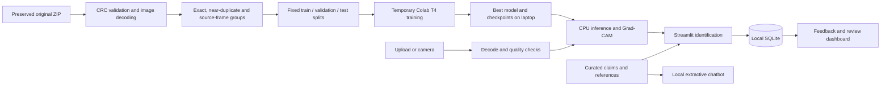

# Architecture

The application is a local research prototype. Python services handle inference, image checks, curated retrieval
and SQLite persistence; Streamlit provides the interface. No external LLM or permanent cloud storage is required.

## Modules

- `scripts/prepare_dataset.py`: original ZIP copying, full CRC/SHA validation, canonical extraction, image validation,
  duplicate grouping and reproducible processing. `refine_parent_groups.py` records the pre-training filename-group
  refinement without re-decoding the raw images. `dataset/processed/manifest.json` is the authoritative final split.
- `training/data.py`: class discovery, safe datasets, RGB letterboxing, augmentation and ImageNet normalization.
- `training/train.py`: frozen classifier-head training, upper-layer fine-tuning, inverse-frequency training loss,
  AdamW, learning-rate scheduling, mixed precision on CUDA, early stopping and self-contained checkpoints.
- `training/evaluation.py`: validation-only temperature calibration and review threshold; held-out reports,
  precision/recall/F1, confusion matrices, confidence reliability, timing and Grad-CAM.
- `training/run_job.py`: GPU-only execution, runtime provenance, status reporting and final archive export.
- `weed_assistant/inference.py`: strict loading of genuine completed exports, calibrated top-5 scoring and explanation.
  A lock protects the shared model when Streamlit sessions request inference or Grad-CAM concurrently.
- `weed_assistant/quality.py`: size limits, image decoding, resolution, blur, lighting and visible-green-area checks.
  These checks are advisory and are not an independently validated plant detector.
- `weed_assistant/database.py`: parameterized SQLite queries, foreign keys, prediction history, feedback, reviews,
  sourced species records and separately stored unverified correction drafts.
- `weed_assistant/knowledge.py` and `chatbot.py`: claim-level references, species aliases and local TF-IDF retrieval.
  Answers display existing claims. Unsupported topics and pesticide dosing are declined; drafts never become evidence.
- `app/main.py`: nine-page navigation, persistent page URLs, sidebar and central error boundary.
- `app/ui.py`: cached model/knowledge/retrieval resources, shared components and context transfer.
- `app/views/`: dashboard, identification, species exploration, management, chat, history, review, performance and about.
  Native Streamlit widgets own actions; custom CSS supplies the design system. Plotly reads saved genuine artifacts.

The identification service supports session-only inference followed by explicit saving. Field-crop context is stored
without reranking. Retained photographs are optional. History filters execute parameterized SQLite queries; counts
use SQL aggregates. Deletion confirms explicit IDs, removes dependent feedback/reviews transactionally and only
unlinks unreferenced photographs inside `app/uploads/`. User drafts remain separate from curated knowledge.

## Notebook execution and transfers

`tools/notebook-control/` contains a small project-scoped VS Code extension. It uses the public notebook and
commands APIs and the official Colab filesystem provider. Only a workspace carrying `.weed-control/enabled`
is handled, and local file paths are restricted to this project. It does not read authentication secrets,
change Google credentials, create tunnels, or bypass Google restrictions.

The original large archive transfer was rejected by the Jupyter contents service. Eight-MiB parts were uploaded
with the official Colab command. The runtime verifies each part and the joined archive with SHA256. A compressed
final manifest reuses those exact pixels while applying the final source-frame-aware split assignments.
The primary delivered notebook can also use the final prepared archive directly.

The automated launcher starts a single ordinary training subprocess from a Colab notebook cell so the notebook
can remain usable for progress monitoring. The training process has no CPU fallback. Its own status and error files
are authoritative. Notebook cell completion alone does not prove model training completed.

Model and checkpoint retrieval uses the authenticated Colab filesystem provider managed by the extension. Files
must be copied to the laptop to survive deletion of the runtime. The process does not create permanent cloud storage.

## Data and evaluation boundaries

The training split is the only split used for optimization. Validation controls scheduling, early stopping,
temperature fitting and the review threshold. The test set is evaluated only after the best checkpoint is selected.
The split manifest and hashes are saved with the run, and local verification checks the exported model against
the complete held-out split and the GPU prediction arrays.

The publisher's longitudinal plant identifiers are absent. Filename crop families and detectable duplicates are
grouped, but related growth-stage observations can remain across splits. No independent field or labeled
unknown-species dataset is available. Confidence rejection is a review mechanism, not proven open-set recognition.

## Deployment scope

The server binds to `127.0.0.1:8501`. Images, database and outputs remain local. It has no multi-user authentication
or public hosting configuration. A public deployment needs an explicit security/access design, operational monitoring,
independent field validation and local botanical/agronomic review; those are not silently assumed complete.
